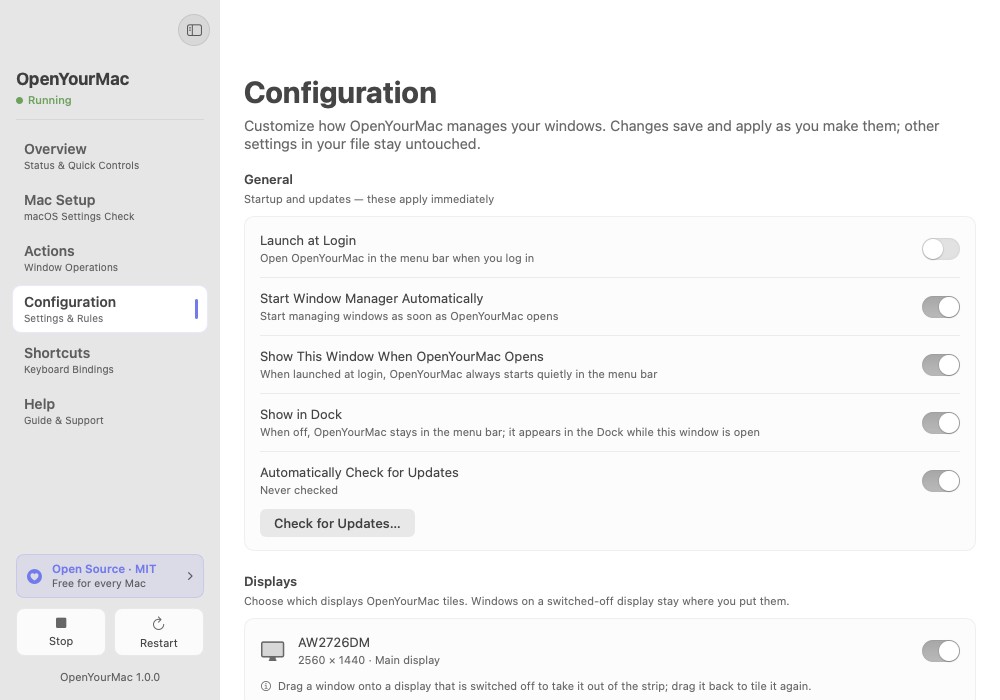
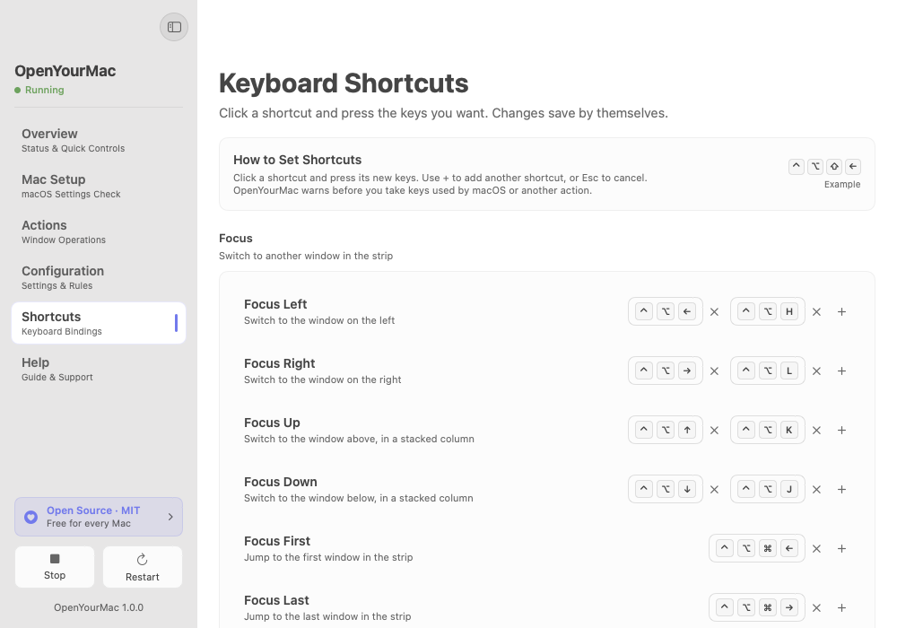

<p align="center">
  
</p>

<h1 align="center">OpenYourMac</h1>

<p align="center">
  A free, open-source scrolling window manager for macOS.<br>
  Your windows sit side by side on one long strip. The strip slides to the window you use.
</p>

<p align="center">
  <picture>
    <source media="(prefers-color-scheme: dark)" srcset="docs/images/configuration-dark.png">
    
  </picture>
</p>

## Why a strip?

Grid tilers shrink every window to fit the screen. On a laptop that quickly
makes windows too narrow. A strip keeps windows at a readable width. Your screen
shows part of the strip. Focus a window and the strip slides to reveal it.
Each managed display has its own strip.

OpenYourMac is an independent open-source app inspired by ChainYourMac and built
on [Paneru](https://github.com/karinushka/paneru). It is not affiliated with or
endorsed by ChainYourMac or its developer. OpenYourMac uses its own config path,
`openyourmac://` URL scheme, and `openyourmac` CLI, described below.

## Features

- Strip layout with preset widths, full width, and column centering options.
- Stacks and tabs: show several windows in one column, split or one at a time.
- Pinned columns at the left and right edges.
- A strip minimap with click-to-focus and drag-to-reorder controls.
- Trackpad swipes with snap or free scrolling, plus modifier-and-scroll input.
- Focus borders, inactive-window dimming, gaps, and Dock awareness.
- Session restore, native tab groups, floating dialogs, window rules, and
  per-display controls.
- Editable shortcuts and a Mac Setup page that checks for common conflicts.
- A SwiftUI settings app, Raycast scripts, URL actions, and a CLI.

## Requirements

- macOS 13 or later on Apple silicon. Intel runtime support is not verified.
- Accessibility access to control windows.
- **Displays have separate Spaces** enabled.
- One active window manager. Quit other managers before starting OpenYourMac.

For a safe trial, use a separate macOS account or VM. See
[manual testing](docs/manual-testing.md).

## Install

### Download a release

1. Download the `.dmg` file and its `.sha256` checksum file from
   [GitHub Releases](https://github.com/SergeSerb2/OpenYourMac/releases).
   Release builds are for Apple silicon. Each release also has a ZIP of the same app.
2. In Terminal, go to the download folder and check the file with its checksum,
   for example `shasum -a 256 -c OpenYourMac-1.0.0-macos-arm64-adhoc.dmg.sha256`.
   It must print `OK`.
3. Open the DMG. Drag **OpenYourMac** to **Applications**, then eject the disk image.
4. Open the app from Applications. Ad-hoc-signed releases are not notarized by
   Apple, so macOS can block the first launch. If you trust the release and its
   checksum matches, open **System Settings › Privacy & Security › Open Anyway**,
   then confirm **Open**. This creates an exception for this app. See
   [Apple's first-launch guide](https://support.apple.com/en-us/102445).
5. Complete onboarding and the permission steps below.

### Build from source

Install Xcode with a Swift 6 toolchain and Rust via [rustup](https://rustup.rs).
The engine requires Rust 1.95 or later. From the repository root:

```sh
make            # or: scripts/build-app.sh
```

The result is `build/OpenYourMac.app`. Use `make debug` (or
`scripts/build-app.sh --debug`) for a debug build. `make` adds `~/.cargo/bin`
to `PATH` itself. To run the script directly, put Cargo on your `PATH` first. Move the app to `/Applications` before granting Accessibility.
The script builds the engine without Lua and uses an ad-hoc signature by default.
Run `make ci` locally before opening a pull request. Builds and releases run
only on your Mac; there are no GitHub Actions builds. Use `scripts/release.sh`
to prepare release artifacts, or add `--publish` to create a draft GitHub Release.
See [CONTRIBUTING.md](CONTRIBUTING.md) and the [release guide](docs/releasing.md).

## Permissions

Accessibility lets OpenYourMac read window information, change window positions
and sizes, and handle its window-control input. Grant it in **System Settings ›
Privacy & Security › Accessibility**. The app and its bundled engine use this
access to manage your windows.

[Setup guidance](docs/setup.md) explains permissions, Spaces, trackpad conflicts,
and the Mac Setup page. Mac Setup changes system settings only when you choose
a change. Its Spaces-order fix restarts the Dock.

## Default shortcuts

<p align="center">
  <picture>
    <source media="(prefers-color-scheme: dark)" srcset="docs/images/shortcuts-dark.png">
    
  </picture>
</p>

Every default uses Control + Option (⌃⌥). Change them in **Shortcuts**.
Numbered actions address columns, not individual members of a stack.

| Action | Keys |
| --- | --- |
| Focus left / right / up / down | ⌃⌥ ← → ↑ ↓ (or H L K J) |
| Move window or column | ⌃⌥⇧ + the focus keys |
| Focus column 1–8 / move column there | ⌃⌥ 1…8 / ⌃⌥⇧ 1…8 |
| Focus last column / move column to end | ⌃⌥ 9 / ⌃⌥⇧ 9 |
| Focus first / last | ⌃⌥⌘ ← / → |
| Center / cycle widths / full width | ⌃⌥ C / R / F |
| Wider / narrower | ⌃⌥ = / - |
| Taller / shorter in a stack | ⌃⌥⇧ = / - |
| Equalize stack heights | ⌃⌥ 0 |
| Stack left / unstack | ⌃⌥ ] / ⌃⌥⇧ ] |
| Stack right / unstack to the left | ⌃⌥ [ / ⌃⌥⇧ [ |
| Toggle tabs | ⌃⌥⇧ T |
| Pin left / right | ⌃⌥ P / ⌃⌥⇧ P |
| Float / tile | ⌃⌥ T |
| Move to next display | ⌃⌥ N |
| Show the strip minimap | ⌃⌥ S |
| Quit the window manager | ⌃⌥ Q |

## Configuration

The app uses `~/.config/openyourmac/openyourmac.toml`. It saves changes in place
and preserves comments and unknown keys. The engine reloads the file when it
changes. The app's **Help › Settings File Reference** and the
[default config](resources/default-config.toml) cover the main settings.
They are not a complete list of accepted engine keys.

```toml
[options]
gap_inner = 8
center_focused_column = "on-overflow"
swipe_gesture_fingers = 4

[bindings]
window_focus_west = ["ctrl + alt - leftarrow", "ctrl + alt - h"]

[windows.pip]
title = 'Picture.*(in)?.*[Pp]icture'
floating = true
```

See the [engine config guide](engine/CONFIGURATION.md) for discovery, validation,
file-only options, and the priority of compatibility settings. Dimensions use
logical screen points.

## Automation

Install the CLI from **Help › Integrations › Install CLI**. The app creates
`~/.local/bin/openyourmac`. Add that directory to your shell's `PATH` if needed:

```sh
export PATH="$HOME/.local/bin:$PATH"
```

With onboarding complete, Accessibility granted, and the manager running:

```sh
open -g "openyourmac://window/focus/east"
openyourmac window swap west
openyourmac strip show
```

`openyourmac start`, `stop`, `restart`, and `toggle` send background URLs to the
app. A successful URL dispatch does not prove the engine completed the action.
Window commands use the engine's `send-cmd` interface. They report parsing and
connection errors, but success means delivery, not a verified window move.

Export Raycast scripts from **Help › Integrations**. See the
[Raycast and URL guide](resources/raycast/README.md) for installation and routes.

## Troubleshooting and FAQ

**Accessibility was lost after a rebuild or update.** Keep one app copy in
`/Applications`. Ad-hoc rebuilds can change its signature. Use **Help ›
Troubleshooting › Repair Permission…**, then allow it again in Accessibility.

**Windows jump or shortcuts fail.** Quit other window managers and disable their
login items. Check **Mac Setup** and shortcut conflicts. Two managers can act on
the same windows and keys.

**The engine asks for separate Spaces.** Enable **Displays have separate Spaces**
in **System Settings › Desktop & Dock › Mission Control**, then log out and in.

**The config does not load.** Read the error in Overview. Validate the file without
moving windows:

```sh
/Applications/OpenYourMac.app/Contents/Resources/OpenYourMacEngine check-config "$HOME/.config/openyourmac/openyourmac.toml"
```

Review warnings as well as the exit status. A skipped binding can produce a
warning even when validation succeeds.

**Where is the log?** `~/Library/Logs/OpenYourMac/engine.log`. Reveal it from
**Help › System Information**. Detailed logging includes window titles. Review
logs for private data before sharing them and turn detailed logging off afterward.

**How do updates work?** The app checks GitHub Releases when automatic checks are
on, at most once a day. It opens the release page for a newer version. Download
and replace the app yourself; it does not install updates.

**Do I need a license key?** No. OpenYourMac is MIT-licensed open-source software.

For more setup help, see [docs/setup.md](docs/setup.md). Report reproducible
problems through [GitHub Issues](https://github.com/SergeSerb2/OpenYourMac/issues).

## Uninstall

1. Turn off **Launch at Login** in OpenYourMac's menu bar menu. This unregisters
   its macOS login item (`SMAppService.mainApp`). You can also remove it in
   **System Settings › General › Login Items**.
2. Stop the window manager in the app, then quit OpenYourMac from its menu bar
   menu. Closing the settings window alone does not quit it.
3. If you installed the CLI, inspect `readlink "$HOME/.local/bin/openyourmac"`.
   If it points to this app's bundled `openyourmac-cli`, remove just that link
   with `rm "$HOME/.local/bin/openyourmac"`. Keep any unrelated file or link.
   Remove a PATH line you added only for this tool if you no longer need it.
4. Remove the exported **OpenYourMac Raycast** directory from Raycast's Script
   Commands settings, then delete that folder from the location you chose.
   Replaced exports may also remain in Trash.
5. Move `/Applications/OpenYourMac.app` to Trash. Remove other copies you made.
6. To erase saved data, remove these app-specific items after quitting:

   - `~/.config/openyourmac/`: config, `openyourmac.toml.backup-*` reset backups,
     and any interrupted `.oym-*.tmp` writes.
   - `~/.local/state/openyourmac/`: `state.json` session layouts,
     `script-state.json` client state, and any interrupted `*.json.tmp` writes.
     If you set `XDG_STATE_HOME`, use `$XDG_STATE_HOME/openyourmac/` instead.
     If you set `OYM_STATE_FILE`, also remove that custom session file.
   - `~/Library/Logs/OpenYourMac/`: the engine log.

7. Delete app preferences with `defaults delete com.openyourmac.OpenYourMac`.
   This clears startup, Dock, update, onboarding, logging, and saved window
   preferences in `~/Library/Preferences/com.openyourmac.OpenYourMac.plist`.
   A missing domain means there are no saved preferences to delete.
8. Remove OpenYourMac from **Privacy & Security › Accessibility**. If Mac Setup
   changed Spaces ordering, or you changed trackpad, tiling, Stage Manager, or
   display settings, restore your choices in System Settings.

## Contributing and security

Read [CONTRIBUTING.md](CONTRIBUTING.md), the
[Code of Conduct](CODE_OF_CONDUCT.md), and the
[manual checklist](docs/manual-testing.md). Report security issues privately as
explained in [SECURITY.md](SECURITY.md).

## Project layout

| Path | Purpose |
| --- | --- |
| `app/` | SwiftUI settings and engine supervisor. |
| `engine/` | Rust window engine, forked from Paneru v0.5.2. |
| `resources/` | Default config, CLI wrapper, and Raycast scripts. |
| `scripts/` | Local checks, release packaging, bundle assembly, and icons. |
| `assets/` | App icon source and generated icon. |
| `docs/` | Public setup, architecture, and manual testing guides. |

See [architecture](docs/architecture.md) and [artwork sources](docs/assets.md).

## Acknowledgements

[Paneru](https://github.com/karinushka/paneru) by Karinushka supplies the MIT-licensed
engine base. [PaperWM](https://github.com/paperwm/PaperWM) and
[niri](https://github.com/YaLTeR/niri) show the scrolling-strip approach.

## License

[MIT](LICENSE). Paneru's license is preserved in
[engine/LICENSE.txt](engine/LICENSE.txt). See
[THIRD_PARTY_NOTICES.md](THIRD_PARTY_NOTICES.md) for dependency notices.
